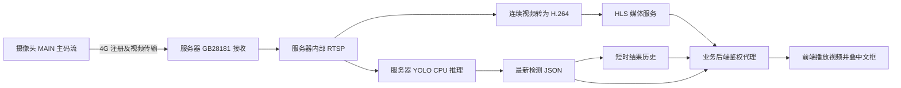

# 4G 摄像头安全帽与反光背心检测后端接入说明

> 2026-10-22 部署更新：算法在 GPU，业务后端在 252；跨机调用使用 GPU HTTPS 可达地址。本文历史回环/SSH 地址由 [GPU 与 252 交接文档](GPU_252_HANDOFF_20261022.md) 替代。启动脚本见 [deploy/README.md](../deploy/README.md)，本次不新增前端。

日期：2026-10-09，UTC+08:00。适用对象：业务后端、前端和部署人员。

首期接入“摄像头通过 4G 传输高清主码流，服务器执行 YOLO 推理，业务页面显示原视频及中文检测框，并按人员展示安全帽、反光背心穿戴状态”。人脸识别、实名关联、打卡和语音播报暂不接入。

现有服务提供连续视频和检测 JSON。业务后端负责鉴权、代理和结果分发，前端负责在视频上叠框。当前视频文件或视频流中**没有烧入服务器的 PPE 检测框**；直接播放媒体流只会看到摄像头原画面及已有原厂叠加。

## 1. 接入范围与运行依据

| 项目 | 已有能力与边界 |
| --- | --- |
| 4G 主码流 | 已在摄像头拔掉网线的情况下，实际接通公网 GB28181 收流及服务器推理；使用 MAIN，不走 FTP 图片上传 |
| 视频 | 实测输入 HEVC、2560×1440，约 15 帧/秒；浏览器兼容输出 H.264，保持相同分辨率和连续播放 |
| 推理 | CPUExecutionProvider，ORT 4 线程，采样上限 4 次/秒；完整 30 秒窗口实测成功提交约 3.00 次/秒，与视频播放帧率独立 |
| 对外检测类别 | `hardhat`、`no-hardhat`、`safety vest`、`no-safety vest`；人员用于穿戴关联，不作为额外显示类别 |
| 数据接口 | 单摄像头状态、最新检测 JSON、短时结果历史；Bearer 或 Basic 鉴权，具体见第 3 节 |
| 业务接入 | 原业务后端尚未接入；现有 HTTP 接口绑定服务器回环地址，尚无对业务开放的 HTTPS 域名 |
| 状态确认 | 当前提供瞬时观测；时序确认关闭，不能当成已确认违规事件 |

纯 4G 视频、推理和 HLS 正常运行的保存记录来自当天 15:22；四类输出过滤在 16:16 的保存记录中已部署、工作进程健康，但当时摄像头处于有线管理状态，结果接口返回 503。**恢复纯 4G 后的四类实时输出仍须在联调时确认**。以上是保存记录的结果，不代表此刻在线状态。

## 2. 视频与数据链路



摄像头通过 4G 注册到公网服务器，GB28181 建立主码流会话后接收视频。服务器内的算法再读取接收端输出的 RTSP。业务后端无需直接访问摄像头的局域网 IP，也无需通过手机睿博士 App 取流。

服务器 `127.0.0.1` 是**已经收到 4G 视频后的内部服务地址**。它不表示从电脑回环获取摄像头，也不表示摄像头改走网线。

### 服务器与组件

服务器：`211.139.12.141`。独立项目目录：`/home/haha/4g-camera-inference`。

| 服务或地址 | 用途 | 后端是否直接使用 |
| --- | --- | --- |
| 公网 `211.139.12.141:25060`，UDP/TCP；RTP 端口 `30000–30007` | 摄像头 GB28181 注册、信令及视频传输 | 否，属于摄像头到接收端的通道 |
| `rtsp://127.0.0.1:12854/camera_main?stream=0` | 已收到的原始 MAIN 视频，HEVC | 仅服务器内部算法使用 |
| `rtsp://127.0.0.1:28554/raw-main` | 连续 H.264 视频，需媒体读凭据 | 后端有 RTSP 消费需求时使用 |
| `http://127.0.0.1:28888/raw-main/index.m3u8` | 内部 HLS，需媒体读凭据及会话处理 | 首期经 28880 代理使用 |
| `http://127.0.0.1:28878` | 推理状态与最新 JSON | 是，服务端 Bearer 请求 |
| `http://127.0.0.1:28880` | HLS 同源代理、短时历史、现有演示页面 | 是，服务端 Basic 请求 |
| 电脑 `http://127.0.0.1:18886/` | 现有 SSH 预览代理 | 仅人工预览，不作为业务后端地址 |

WebRTC 尚不作为首期可用接口。`annotated-main` 是候选配置中的路径，当前推理工作进程关闭视频发布，不能用它代替 `raw-main`。

## 3. 现有 HTTP 接口与鉴权

下面地址均以**推理服务器所在网络命名空间**为准。其他服务器或 Docker 容器中的 `127.0.0.1` 不会自动指向它，须通过受控隧道或独立访问网关连接。

### 最新结果与状态

基础地址：`http://127.0.0.1:28878`。

```http
Authorization: Bearer <PPE_VIDEO_CAMERA_TOKEN 的实际值>
```

| 方法与路径 | 响应 | 使用权限 |
| --- | --- | --- |
| `GET /v1/cameras/camera-01/status` | 摄像头连接、结果可用性、解码与推理计数 | 摄像头 token；管理 token 也可访问 |
| `GET /v1/cameras/camera-01/results` | 最新新鲜检测结果，直接返回 JSON 对象，无 `data` 包装 | 摄像头 token；管理 token 也可访问 |
| `GET /healthz` 或 `GET /v1/status` | 工作进程运行状态 | 仅管理 token |

摄像头标识当前为 `camera-01`。不要把摄像头管理员密码或 SSH 登录密码用作 API token。token 由服务器私有环境配置管理；`PPE_VIDEO_ADMIN_TOKEN` 与 `PPE_VIDEO_CAMERA_TOKEN` 是不同凭据。业务读取使用摄像头 token，管理 token 不下发前端。

`status` 返回 HTTP 200 仅说明状态查询成功；仍需判断 `connected`、`result_available` 和 `decoded_frame_age_seconds`。`healthz` 也不能代替视频在线检查。

### HLS 与短时历史

基础地址：`http://127.0.0.1:28880`。使用 HTTP Basic，用户名 `viewer`，密码为服务器私有环境变量 `PPE_PREVIEW_PASS` 的实际值。

| 方法与路径 | 用途 |
| --- | --- |
| `GET /media/hls/raw-main/index.m3u8` | HLS 主播放列表 |
| `GET /media/hls/raw-main/<媒体文件名>` | 播放列表及分片请求，必须与主播放列表一起代理 |
| `GET /api/results-history` | 当前会话短时结果历史，用于画面叠框 |
| `GET /config.public.json` | 叠框配置、历史窗口、误差阈值、尺寸和方向要求 |
| `GET /` | 现有演示页面，可用于先行联调 |

28880 会在服务端处理内部媒体认证及 HLS 会话。业务端不要把 `PPE_MEDIA_READ_PASS` 或内部媒体 URL 下发浏览器。现有预览没有 `/api/results`、`/api/status` 接口；最新结果和状态使用 28878 上的 `/v1/cameras/...` 路径。

### 错误与缓存

推理 API 设置 `Cache-Control: no-store`。后端与网关也应禁止缓存最新状态和 JSON。

| HTTP 状态或内容 | 含义与处理 |
| --- | --- |
| `401` | 凭据缺失或不匹配；停止高频重试并检查服务端凭据 |
| `404` | 路径不正确或摄像头标识不存在 |
| `503`，`{"error":"result_unavailable"}` | 断流、启动中或没有新鲜结果；撤回框和实时穿戴状态 |
| `503`，`{"error":"diagnostic_jpeg_disabled"}` | 当前关闭诊断 JPEG；首期无需调用 `/frame.jpg` |
| `500`，`{"error":"internal_error"}` | 推理 API 内部异常，按暂不可用处理 |
| 预览 `502`，`media_unavailable` | HLS 上游暂不可用；清框，视频重连 |
| 历史接口 `200`，`state != "fresh"` 或 `results: []` | 无可用历史；不能因 HTTP 200 保留旧框 |
| 超时、连接被关闭 | 服务不可用或有界并发限制触发；有退避地重试 |

最新结果的服务端 TTL 当前为 4 秒，按推理输入帧的接收时间计。前端叠框另有更严格的新鲜度限制，见第 6 节；不能把 4 秒 TTL 理解成允许冻结旧框 4 秒。

## 4. 检测 JSON 与穿戴状态

### 字段约定

| 字段 | 含义与使用方式 |
| --- | --- |
| `schema_version` | 当前为 `1`；升级时先核对契约 |
| `camera_id`、`view_id`、`source_stream` | 摄像头、视角、主码流标识；`source_stream` 为 `MAIN` |
| `session_id`、`capture_epoch`、`sequence` | 结果身份；会话和重连代次用于隔离旧结果 |
| `frame_size` | `[宽, 高]`，当前实测 `[2560, 1440]` |
| `coordinate_space` | `oriented_source_pixels`；框是完成声明旋转/镜像后的源图像像素坐标 |
| `rotation_degrees`、`mirror_horizontal` | 当前为 `0`、`false`；变化时须重新处理坐标 |
| `received_at_utc` | 服务器解码接收该推理输入帧的 UTC 时间，非摄像头曝光时间 |
| `processed_at_utc` | 服务器完成本次处理的 UTC 时间 |
| `source_pts_seconds`、`source_pts_status` | 源相对时间戳及质量；当前可能重复或回退，不能直接作可靠的画面对齐或考勤时间 |
| `inference_ms` | 本次模型推理耗时；不等于网络、视频播放或整个请求延迟 |
| `processed_results_count` | 进程生命周期内成功提交的新鲜结果累计次数；可计算实际结果更新率 |
| `detections` | 仅四种 PPE 类别，供画面绘框；每项含 `label`、`confidence`、`box` |
| `persons` | 匿名人员轨迹及其 PPE 关联，供逐人状态列表；人员本身不是新增显示类别 |
| `temporal_confirmation_enabled` | 当前 `false`；瞬时观测没有转为时序确认 |
| `sensor_exposure_utc_verified`、`field_accuracy_verified` | 当前 `false`；不可据此宣称曝光时间或现场精度已验收 |
| `frame_jpeg_path` | 当前 `null`，无需等待 JPEG |

`box` 是 `[x1, y1, x2, y2]`，不是 `[x, y, width, height]`，也不是归一化坐标。`confidence` 为 0–1 模型分数，前端显示百分数即可，不是经过校准的违规概率。其余诊断字段可以保留，业务代码应容忍新增字段。

结果去重键使用 `(camera_id, session_id, capture_epoch, sequence)`，不能只用 `sequence`。人员轨迹键再加入 `tracking_epoch` 与 `track_id`；它是匿名短期视频轨迹，不能当作实名人员、跨摄像头身份或打卡 ID。

### 中文标签和逐人状态

后端保留英文枚举，前端使用以下中文映射；不要修改模型类别文件。

| JSON 类别 | 中文检测框 | 对应装备与观测值 |
| --- | --- | --- |
| `hardhat` | 安全帽 | `helmet: worn` |
| `no-hardhat` | 未戴安全帽 | `helmet: not_worn` |
| `safety vest` | 反光背心 | `vest: worn` |
| `no-safety vest` | 未穿反光背心 | `vest: not_worn` |

逐人列表使用 `persons[].observed_states` 展示**当前观测**。当前运行策略下，`persons[].states` 与 `raw_states` 被置为 `unknown`，`reasons` 为 `stream_timing_not_accepted`，用于明确尚未接受时序确认。`observed_states` 才保留关联算法在本次输入上的瞬时判断；`evidence.helmet`、`evidence.vest` 保存归属于该人的检测证据。

| 观测值 | 安全帽显示 | 反光背心显示 |
| --- | --- | --- |
| `worn` | 当前观测：已戴安全帽 | 当前观测：已穿反光背心 |
| `not_worn` | 当前观测：未戴安全帽 | 当前观测：未穿反光背心 |
| `unknown` 或字段缺失 | 安全帽：无法判断 | 反光背心：无法判断 |

没有检测到安全帽，不等于检测到“未戴安全帽”。只有明确的 `no-hardhat` 证据且成功归属当前人员，才形成对应的负向观测。反光背心同理。人员太小、身体被截断、遮挡、多人归属不清或正负证据冲突时，关联算法会返回 `unknown`。

`tracking_status == "temporarily_lost"` 的短时丢失轨迹显示无法判断，不沿用旧的已戴/未戴结论。只有装备检测但无法归属人员时，可以显示装备框，不能将它分配给最近的人。`persons: []` 表示本次没有可输出的人员轨迹，不代表现场无人或所有人合规。

业务首期可以显示瞬时状态和框，入库时应保留“当前观测”的语义，不自动提升为“已确认违规”。实名、报警确认、事件去重与证据留存不属于当前接口已经完成的能力。

### 最新结果示例

以下是**便于开发的节选示例，数值非现场新采样**。实际响应还含模型、跟踪及媒体诊断字段。

```json
{
  "schema_version": 1,
  "camera_id": "camera-01",
  "view_id": "4g-main-validation-view",
  "source_stream": "MAIN",
  "session_id": "example-session",
  "capture_epoch": 1,
  "sequence": 631,
  "frame_size": [2560, 1440],
  "coordinate_space": "oriented_source_pixels",
  "rotation_degrees": 0,
  "mirror_horizontal": false,
  "received_at_utc": "2026-10-09T07:22:00.000Z",
  "processed_at_utc": "2026-10-09T07:22:00.180Z",
  "source_pts_seconds": 46.0,
  "source_pts_status": "unstable",
  "source_pts_policy": "observe",
  "sensor_exposure_utc_verified": false,
  "temporal_confirmation_enabled": false,
  "inference_ms": 155.4,
  "processed_results_count": 1800,
  "detection_tasks": ["safety_helmet", "reflective_vest"],
  "detections": [
    {"label": "no-hardhat", "confidence": 0.87, "box": [750, 100, 1200, 500]},
    {"label": "safety vest", "confidence": 0.91, "box": [650, 500, 1300, 1100]}
  ],
  "persons": [
    {
      "box": [500, 100, 1500, 1400],
      "confidence": 0.9,
      "track_id": 1,
      "tracking_epoch": "example-tracking-epoch",
      "tracking_status": "observed",
      "observation_age_seconds": 0.0,
      "observed_states": {"helmet": "not_worn", "vest": "worn"},
      "raw_states": {"helmet": "unknown", "vest": "unknown"},
      "states": {"helmet": "unknown", "vest": "unknown"},
      "reasons": {"helmet": "stream_timing_not_accepted", "vest": "stream_timing_not_accepted"},
      "evidence": {
        "helmet": [{"label": "no-hardhat", "confidence": 0.87, "box": [750, 100, 1200, 500]}],
        "vest": [{"label": "safety vest", "confidence": 0.91, "box": [650, 500, 1300, 1100]}]
      }
    }
  ],
  "diagnostic_jpeg_enabled": false,
  "inference_worker_publishes_display_video": false,
  "field_accuracy_verified": false,
  "frame_jpeg_path": null
}
```

该人员在业务列表中显示“当前观测：未戴安全帽／已穿反光背心”。不能将 `states.helmet == unknown` 改成已确认未戴，也不能仅看原视频红框推断 PPE 状态。

## 5. 业务后端代理与分发

业务后端不需要重新执行 YOLO。首先代理现有视频与 JSON，再将其挂到已有用户登录和摄像头权限体系下。

以下为**业务侧待实现的路径约定**，不是服务器现有接口：

| 业务侧路径 | 上游现有接口 | 服务端携带凭据 |
| --- | --- | --- |
| `/api/ppe/cameras/camera-01/status` | `28878/v1/cameras/camera-01/status` | 摄像头 Bearer token |
| `/api/ppe/cameras/camera-01/results` | `28878/v1/cameras/camera-01/results` | 摄像头 Bearer token |
| `/api/ppe/cameras/camera-01/history` | `28880/api/results-history` | `viewer` Basic |
| `/api/ppe/cameras/camera-01/overlay-config` | `28880/config.public.json` | `viewer` Basic |
| `/ppe-live/camera-01/media/hls/raw-main/<文件名>` | `28880/media/hls/raw-main/<文件名>` | `viewer` Basic |

业务端按项目习惯调整路径即可，保留上游语义。视频代理需要转发主播放列表、子播放列表、初始化段和媒体分片；保留 HLS 查询参数、`Range` 请求及对应响应。加业务路径前缀时，还要重写代理返回的 `Location` 到同一业务前缀，不能让浏览器跳到内部地址或漏掉前缀。不要只代理一条 `index.m3u8` 请求。

一个摄像头由一个后台采集任务读取结果并分发给多个观看者，避免每个浏览器各自请求推理 API。现有预览已约每 200 ms 读取一次结果并建立短时历史，可以直接复用 `/api/results-history`；业务端无需再开第二个高频采集循环。若独立实现结果采集，可按 250–500 ms 间隔串行读取、设置请求超时，禁止请求堆积；重复结果只更新可用性，不重复创建业务事件。

上游返回 503、超时或会话变化时，业务响应要明确给出暂不可用，并清除实时框和穿戴摘要。不要把缓存的最后一个成功结果伪装成当前结果。若业务保留历史记录，应带原始时间与结果身份，和实时展示分开。

### 部署位置选择

业务后端与推理进程在同一主机且共享主机网络时，可以直接访问回环接口。业务后端在另一台服务器时，先建立受控连接，再把上表的上游地址配置到业务服务；不能直接请求 `http://211.139.12.141:28878`，因为它当前没有公网监听。

远端开发联调可以使用 SSH 转发，下面是手动命令示例，**本次没有执行或创建隧道**：

```bash
ssh -N -p 22 \
  -L 127.0.0.1:38878:127.0.0.1:28878 \
  -L 127.0.0.1:38880:127.0.0.1:28880 \
  haha@211.139.12.141
```

随后业务开发机上的上游地址为 `http://127.0.0.1:38878` 和 `http://127.0.0.1:38880`，鉴权方式不变。正式接入应确定业务后端部署位置、HTTPS 域名及访问授权；新增独立网关或隧道时保持原 Java、nginx、数据库及其他媒体服务的配置不变。

## 6. 前端视频叠框与逐人展示

前端用 HLS 播放连续视频，用透明 Canvas 绘制四类 PPE 框。人员穿戴列表读取 `persons`；不需要额外绘制“人员”类别框。可以直接复用项目现有 `preview.js` 的四类中文映射、坐标缩放与 `overlay_logic.js` 的历史选择逻辑。

HLS 有播放缓冲，视频里的画面通常比最新 JSON 更早。**最新 JSON 用于当前状态摘要，播放中的检测框必须从历史结果中选取**，不能把最新框直接画到延迟播放的画面上。逐人列表若与播放画面一起展示，也应取与画面匹配的那条历史结果；若取最新结果，明确标注“最新观测”。

### 历史响应

`GET /api/results-history` 返回以下结构；示例中的 `results` 每项是第 4 节结果的精简副本，并增加 `decoder_received_epoch_ms`，不含内部媒体 URL 或凭据。

```json
{
  "server_now_epoch_ms": 1791530520180,
  "state": "fresh",
  "latest_result_age_ms": 180,
  "alignment": "decoder_receive_time_estimate_not_sensor_exposure",
  "results": []
}
```

以上结构示例把结果数组省为空，不能据此显示框；实际绘制要求 `state == "fresh"` 且数组非空。当前缓存最近 10 秒，最多 100 条，按帧身份去重。上游断流或请求失败会清空历史；新 `session_id` 或 `capture_epoch` 会清除旧会话结果。

### 时间匹配规则

当前 `alignment_mode = receive_time_estimate`、`overlay_timing_verified = false`。对齐基于服务器解码接收时间和 HLS 播放时间锚，是近似显示，不是已经验证的同帧匹配。

1. 通过 HLS.js `playingDate` 获取正在播放画面的时间锚，并读取配置中的 `overlay_clock_offset_ms`。
2. 利用 `server_now_epoch_ms` 与请求往返中点估计客户端与服务器时钟差。
3. 只在最新会话/代次的历史中，选择时间不晚于校正后播放时间的最近一条。
4. 播放时间与选中结果的接收时间差不超过 500 ms；最新输入结果年龄不超过 1000 ms；历史请求超过 1000 ms 未更新则撤框。
5. 视频暂停、等待数据、约 750 ms 未出现新视频帧、时间锚缺失、历史过期、尺寸/方向不匹配或接口错误时，清空叠框。

按配置核验实际视频尺寸、旋转和镜像；当前绘框实现仅接受源像素坐标、旋转 0 度、无镜像，并要求 `frame_size` 与视频固有尺寸一致。Safari 原生 HLS 或其他播放器若取不到同样的播放时间锚，可以播放视频，但不能照搬“最新框”替代历史匹配。

### 框坐标与留黑边

使用 `object-fit: contain` 时，以视频实际显示区域计算坐标。设 Canvas CSS 宽高为 `W, H`，源视频宽高为 `w, h`：

```text
s = min(W / w, H / h)
ox = (W - w * s) / 2
oy = (H - h * s) / 2
框左上角 = (ox + x1 * s, oy + y1 * s)
框宽高   = ((x2 - x1) * s, (y2 - y1) * s)
```

Canvas 同步处理设备像素比；全屏、窗口缩放后重新计算。不要把坐标直接缩放到整个容器而忽略留黑边。若产品改用 `cover` 裁切，须另行计算裁切偏移。

摄像头原视频可能已经带红色人形检测框和 `AI IPC` 字样。它们来自原厂画面，关闭网页叠框后仍可能存在；服务器新增框依据 JSON 显示中文。当前不通过业务前端删除已烧入原帧的红框。

## 7. 首期联调步骤与交付条件

1. 确定业务后端在本机、同服务器或另一台服务器部署，并取得摄像头 API token 与 viewer 凭据；凭据只保存在服务端配置。
2. 按第 3 节读取 `status`。确认 `connected == true`、`result_available == true`，再读取最新结果；检查 `source_stream == MAIN` 与实际 `frame_size`。
3. 代理并播放 HLS，核对画面时间持续更新、视频实际尺寸和解码无大块色块；不能只以播放列表 HTTP 200 判定画面可用。
4. 接入短时历史和公开叠框配置，显示四类中文框及逐人两项观测状态。字段缺失、遮挡和关联不确定时显示“无法判断”。
5. 恢复摄像头仅 4G 传输后，确认实际结果 `detections` 仅含四个允许枚举，并验证戴/未戴安全帽、穿/未穿反光背心的真实场景。只以实际出现的类别记录验收，不把示例 JSON 当现场证据。
6. 观察断流与重新连接：撤回旧框和旧状态；重连产生新会话后不复用旧轨迹。不必重新编写一套测试工程，保留联调响应和真实画面即可。

首期完成标志：业务登录用户能观看纯 4G 传来的连续高清画面，画面上出现中文 PPE 框，人员列表有两项穿戴观测状态，断流时能撤回旧结果。当前不是全帧 15 次/秒推理，也不是已验证的自动违规告警系统。

正式接入仍需业务方给出后端部署地址/代码位置、对外域名及前端挂载位置；若不需要对外访问，可先通过 SSH 联调。暂不需要人脸照片、人脸库或打卡接口。

## 8. 运维边界与交接经验

当前五个自有服务为 `4g-camera-gb.service`、`4g-camera-media.service`、`4g-camera-inference.service`、`4g-camera-preview.service`、`4g-camera-display.service`，共用 `camera4g.slice`。已保存的内核资源限制为全任务合计最多 8 逻辑核、4 GiB 内存；推理进程上限 3 GiB。首期接入沿用现有 ORT 4 线程/采样上限 4 次每秒，不扩大配额、不修改其他服务内容。

| 遇到的问题 | 已采用的处理与接手经验 |
| --- | --- |
| App 正常而电脑画面有色块 | 采用独立 H.264 连续显示链路改善浏览器兼容；推理仍读取收到的原主码流，视频与算法更新率分开 |
| 原视频自带红框 | 原厂框已存在于源画面；业务新增框必须依据服务器 JSON，不能把原厂框当本次 PPE 结果 |
| 新网页遗漏中文标签 | 连续视频 Canvas 单独接入四类中文映射；后端英文枚举保持稳定 |
| 类别太多 | 对外 `detections` 过滤为安全帽/反光背心正负四类；仍保留人员关联。模型内部原有 14 类前向尚未裁剪，过滤不意味着计算量已经降低 |
| HLS 视频落后于最新 JSON | 用短时历史匹配过去的播放画面，时间条件不满足则撤框；不宣称曝光时间或精确同帧对齐 |
| 4G 源 PTS 不稳定 | 保留原 PTS 及质量标记，当前关闭时序确认，分开提供瞬时 `observed_states` 与确认状态 |
| 八线程短窗结果较高但触发总配额限流 | 已保留四线程稳定基线；8 秒短窗的约 7.6 次/秒不作为长期帧率承诺 |
| 回环接口无法从另一台服务器直连 | 通过受控连接或独立网关接入；不要把电脑预览地址作为生产入口 |

本次交付为接入文档：依据现有源码和保存部署记录整理，没有修改摄像头、推理服务、其他业务服务或原交接文件，也没有部署上表的业务侧接口。接手时优先完成业务代理和纯 4G 实时四类输出联调。

### 对应代码与记录

| 内容 | 文件 |
| --- | --- |
| 最新结果、状态、鉴权和错误码 | [http_api.py](F:/4G球机/camera_npu/server_transition/video_server_candidate/http_api.py) |
| 四类输出、结果字段和瞬时状态策略 | [video_runtime.py](F:/4G球机/camera_npu/server_transition/video_server_candidate/video_runtime.py) |
| 人员与 PPE 关联、匿名跟踪 | [engine.py](F:/4G球机/camera_npu/server_transition/server_candidate/engine.py)、[tracking.py](F:/4G球机/camera_npu/server_transition/server_candidate/tracking.py) |
| HLS 代理与短时结果历史 | [preview_server.py](F:/4G球机/camera_npu/server_transition/live_overlay_preview/preview_server.py) |
| 中文框、坐标与匹配规则 | [preview.js](F:/4G球机/camera_npu/server_transition/live_overlay_preview/preview.js)、[overlay_logic.js](F:/4G球机/camera_npu/server_transition/live_overlay_preview/overlay_logic.js) |
| 四类过滤部署及实时待验证项 | [PPE_public_scope_deployment_findings_20261009.json](F:/4G球机/camera_npu/server_transition/server_deployment/PPE_public_scope_deployment_findings_20261009.json) |
| 4G、HLS 与结果链路保存状态 | [live_pipeline_final_state_20261009.json](F:/4G球机/camera_npu/server_transition/server_deployment/live_pipeline_final_state_20261009.json) |
| CPU 实测与保留参数 | [live_performance_final_comparison_20261009.json](F:/4G球机/camera_npu/server_transition/server_deployment/live_performance_final_comparison_20261009.json) |
| 主项目交接与历史证据 | [4G 状态与服务器推理交接](F:/4G球机/4G状态与服务器图片推理交接_20261008.md) |
